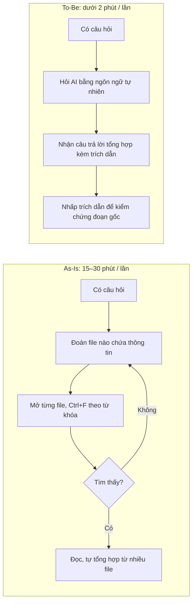

# Tài liệu Yêu cầu Nghiệp vụ (BRD)
## Dự án: Công cụ "Chat với tài liệu" (MVP)

| Thông tin | Chi tiết |
|---|---|
| Mã tài liệu | BRD-CWD-001 |
| Phiên bản | 1.1 (Bản nháp) |
| Ngày tạo | 19/10/2026 |
| Người soạn | Business Analyst |
| Người phê duyệt | Quản lý dự án / Trưởng bộ phận Phát triển Kinh doanh |
| Trạng thái | Chờ phê duyệt |
| Chuẩn tham chiếu | ISO/IEC/IEEE 29148 (đối chiếu ở Phụ lục A) |

### Lịch sử thay đổi

| Phiên bản | Ngày | Người thực hiện | Nội dung thay đổi |
|---|---|---|---|
| 1.0 | 19/10/2026 | BA | Khởi tạo tài liệu |
| 1.1 | 19/10/2026 | BA | Cập nhật theo review checklist IEEE 29148: thêm tầm nhìn, ROI, nhóm người dùng, tuân thủ pháp lý, chính sách bảo mật, tính liên tục; chuẩn hóa câu yêu cầu, thêm lý do và liên kết mục tiêu; sửa mâu thuẫn về lịch trình (BO-04), phạm vi và quyền truy cập |

---

## 1. Tóm tắt dự án

Đội Phát triển Kinh doanh (BD) đang làm việc với số lượng lớn tài liệu PDF như hợp đồng, báo cáo thị trường, hồ sơ đối tác, proposal và chính sách sản phẩm. Thông tin nằm rải rác ở nhiều file, nên mỗi lần cần tra cứu, nhân viên phải mở và đọc từng tài liệu rồi tự tổng hợp. Việc này tốn nhiều thời gian và dễ sót thông tin.

Dự án xây dựng một **MVP ứng dụng web "Chat với tài liệu"**. Người dùng tải lên các file PDF, sau đó đặt câu hỏi bằng ngôn ngữ tự nhiên. AI trả lời dựa trên nội dung của tất cả tài liệu đã tải lên và **chỉ rõ nguồn trích dẫn** (tên file, số trang) để người dùng kiểm chứng được.

### 1.1. Tầm nhìn (Vision Statement)

> **Giúp đội Phát triển Kinh doanh tìm đúng thông tin trong vài giây, kèm bằng chứng nguồn, thay vì mất hàng chục phút lục lọi nhiều file PDF.**

### 1.2. Phù hợp với chiến lược tổ chức

| Định hướng của công ty | Đóng góp của dự án |
|---|---|
| Tăng năng suất và tốc độ phản hồi khách hàng, đối tác | Rút ngắn thời gian tra cứu thông tin (BO-01) |
| Số hóa và chia sẻ tri thức nội bộ | Giảm phụ thuộc vào trí nhớ cá nhân, rút ngắn thời gian onboard (P4) |
| Ứng dụng AI an toàn, có kiểm soát | Thử nghiệm AI ở quy mô nhỏ, có trích dẫn, đo lường được, tuân thủ quy định dữ liệu (mục 9) trước khi mở rộng |

---

## 2. Bối cảnh và vấn đề

### 2.1. Hiện trạng (As-Is)

1. Tài liệu PDF được lưu ở nhiều nơi (email, ổ chung, máy cá nhân).
2. Khi cần một thông tin, ví dụ "điều khoản thanh toán với đối tác X", nhân viên phải:
   - Nhớ hoặc đoán thông tin nằm ở file nào.
   - Mở từng file và tìm bằng Ctrl+F theo từ khóa (cách này không hiệu quả khi không biết đúng từ khóa).
   - Đọc, so sánh và tự tổng hợp từ nhiều file.
3. Nhân viên mới mất nhiều thời gian để nắm toàn bộ bộ tài liệu dự án.

**Tần suất và thời gian (ước tính, sẽ đo baseline ở tuần 1, xem giả định A4):** mỗi nhân viên BD tra cứu khoảng **5 lần/tuần**, mỗi lần mất **15–30 phút**.

### 2.2. Vấn đề cần giải quyết

| # | Vấn đề | Ảnh hưởng |
|---|---|---|
| P1 | Tốn thời gian tìm kiếm và tổng hợp thông tin từ nhiều PDF | Giảm năng suất, chậm phản hồi khách hàng và đối tác |
| P2 | Tìm kiếm theo từ khóa không hiểu ngữ nghĩa | Dễ bỏ sót thông tin quan trọng |
| P3 | Khó nắm bắt toàn bộ nội dung tài liệu | Quyết định kinh doanh có thể thiếu dữ liệu |
| P4 | Kiến thức phụ thuộc vào cá nhân | Khó onboard nhân sự mới, rủi ro khi nhân sự nghỉ việc |

### 2.3. Quy trình mong muốn (To-Be)

1. Người dùng tải các file PDF lên ứng dụng web.
2. Hệ thống tự động xử lý để tài liệu sẵn sàng cho việc hỏi đáp.
3. Người dùng đặt câu hỏi bằng tiếng Việt hoặc tiếng Anh trong khung chat.
4. AI trả lời trong vài giây, kèm trích dẫn file và trang nguồn.
5. Người dùng nhấp vào trích dẫn để xem đoạn gốc và kiểm chứng.

**So sánh As-Is và To-Be:**

| Bước | As-Is | To-Be | Cải tiến |
|---|---|---|---|
| Xác định nguồn | Nhớ hoặc đoán file | Hệ thống tự tìm trong tất cả tài liệu | Không còn phụ thuộc trí nhớ cá nhân (P4) |
| Tìm kiếm | Ctrl+F theo đúng từ khóa | Hỏi theo ý nghĩa | Không bỏ sót khi khác từ ngữ (P2) |
| Tổng hợp | Thủ công từ nhiều file | AI tổng hợp sẵn | Tiết kiệm thời gian (P1, P3) |
| Kiểm chứng | Đọc lại file | Nhấp trích dẫn tới đúng trang | Nhanh và minh bạch (BO-02) |

### 2.4. Quy trình nghiệp vụ hỗ trợ

| Tình huống | Quy trình |
|---|---|
| Tài liệu có phiên bản mới | Người dùng xóa bản cũ (BR-05) rồi tải lên bản mới, để AI không trả lời bằng thông tin lỗi thời |
| AI trả lời sai | Người dùng đánh giá 👎 kèm góp ý (BR-21) → BA tổng hợp hằng tuần trong thời gian pilot → đội phát triển cải tiến |
| Nhân sự nghỉ việc hoặc chuyển bộ phận | Trưởng nhóm BD báo Admin → Admin thu hồi quyền trong 1 ngày làm việc (BR-29, SP-03) |

---

## 3. Mục tiêu kinh doanh

### 3.1. Mục tiêu và KPI

| Mã | Mục tiêu | Chỉ số đo lường (KPI) | Vấn đề giải quyết |
|---|---|---|---|
| BO-01 | Giảm thời gian tra cứu thông tin trong tài liệu | Thời gian trung bình tìm một thông tin giảm từ baseline (đo ở tuần 1, ước tính 15–30 phút) xuống **dưới 2 phút** | P1, P2 |
| BO-02 | Câu trả lời đáng tin cậy, kiểm chứng được | **≥ 80%** câu trả lời được người dùng đánh giá là chính xác (qua nút 👍/👎); **100%** câu trả lời có nội dung từ tài liệu đều có trích dẫn nguồn | P2, P3 |
| BO-03 | Được đội BD chấp nhận và sử dụng | **≥ 70%** thành viên đội BD dùng ít nhất 3 lần/tuần sau 1 tháng pilot | P1, P4 |
| BO-04 | Kiểm chứng tính khả thi trước khi đầu tư bản đầy đủ | MVP sẵn sàng pilot vào **cuối tuần 8**; có kết quả pilot và quyết định go/no-go vào **cuối tuần 12** | — |

### 3.2. Phân tích chi phí – lợi ích (ROI)

**Lợi ích ước tính** (dựa trên giả định A4, sẽ cập nhật sau khi đo baseline):

| Thông số | Giá trị |
|---|---|
| Số người dùng | 20 nhân viên BD |
| Số lần tra cứu | 5 lần/người/tuần, tức 100 lần/tuần |
| Thời gian tiết kiệm mỗi lần | ~18 phút (từ ~20 phút xuống ~2 phút) |
| **Tổng thời gian tiết kiệm** | **~30 giờ công/tuần, tương đương ~130 giờ công/tháng (~0,8 FTE)** |

Lợi ích định tính:
- Phản hồi đối tác nhanh hơn.
- Giảm rủi ro bỏ sót điều khoản.
- Rút ngắn thời gian onboard nhân viên mới.

**Chi phí:**

| Hạng mục | Loại | Ghi chú |
|---|---|---|
| Phát triển MVP | Một lần | 2–4 người × 8 tuần (nguồn lực nội bộ) |
| Dịch vụ AI (theo lượng sử dụng) | Hằng tháng | Kiểm soát bằng hạn mức câu hỏi (BR-32) và theo dõi chi phí (NFR-10) |
| Hạ tầng cloud (máy chủ, lưu trữ, sao lưu) | Hằng tháng | Quy mô nhỏ cho 20 người dùng |
| Vận hành, hỗ trợ | Hằng tháng | Khoảng 0,1–0,2 FTE |

**Tiêu chí ROI đề xuất:**
- Chi phí vận hành hằng tháng (AI + hạ tầng + vận hành) phải **thấp hơn 30% giá trị của 130 giờ công tiết kiệm/tháng**.
- Chi phí phát triển được hoàn vốn trong **≤ 6 tháng** kể từ khi đưa vào sử dụng chính thức.

Trần ngân sách cụ thể do Sponsor xác nhận khi phê duyệt (xem ràng buộc C3).

---

## 4. Phạm vi dự án

### 4.1. Trong phạm vi (In-Scope) của MVP

- Ứng dụng web chạy trên trình duyệt máy tính.
- Tải lên một hoặc nhiều file PDF có lớp văn bản (text-based).
- Quản lý danh sách tài liệu: xem, xem trước, xóa.
- Chat hỏi đáp với AI trên toàn bộ tài liệu hoặc trên các tài liệu được chọn.
- Trích dẫn nguồn (tên file, số trang) trong câu trả lời, nhấp vào để mở đúng trang.
- Lưu và quản lý lịch sử hội thoại.
- Tóm tắt tài liệu tự động (BR-19) và đánh giá câu trả lời 👍/👎 (BR-21).
- Đăng nhập; Admin cấp và thu hồi quyền; nhật ký kiểm toán; hạn mức sử dụng.
- Các tính năng mức **C** (BR-20, BR-22) chỉ làm nếu còn năng lực trong 8 tuần. Nếu không, chuyển sang giai đoạn 2.

### 4.2. Ngoài phạm vi (Out-of-Scope) của MVP

- Xử lý PDF dạng ảnh scan (OCR) – giai đoạn 2 (BR-26).
- Các định dạng khác như Word, Excel, PowerPoint – giai đoạn 2 (BR-27).
- So sánh tài liệu, trích xuất thông tin có cấu trúc – giai đoạn 2 (BR-23, BR-24).
- **Chia sẻ tài liệu giữa người dùng**, workspace theo nhóm, phân quyền theo phòng ban hoặc theo tài liệu – giai đoạn 2 (BR-25).
- Bảng thống kê cho quản lý – giai đoạn 2 (BR-28).
- Ứng dụng di động native.
- Tích hợp với Google Drive, SharePoint, CRM, SSO.
- Chỉnh sửa nội dung tài liệu PDF.
- Thay thế kho lưu trữ tài liệu chính thức. Ứng dụng chỉ là công cụ tra cứu, file gốc vẫn được lưu ở nơi hiện tại.

### 4.3. Ranh giới vận hành

| Hạng mục | Ranh giới |
|---|---|
| Người dùng | Chỉ nhân viên nội bộ đội BD (~20 người) và Admin. Không mở cho khách hàng hay đối tác |
| Truy cập | Qua Internet có xác thực hoặc qua mạng/VPN công ty, theo quyết định của IT |
| Dữ liệu | Mỗi người dùng chỉ thấy tài liệu và hội thoại của chính mình |
| Loại tài liệu | Tài liệu mức **Công khai, Nội bộ, Mật**. **Không** tải lên tài liệu mức **Tuyệt mật** (SP-01) |
| Ngôn ngữ | Tài liệu và câu hỏi bằng tiếng Việt hoặc tiếng Anh |
| Thời gian hỗ trợ | Giờ hành chính (8:00–18:00, thứ Hai đến thứ Sáu) |

---

## 5. Các bên liên quan (Stakeholders)

| Vai trò | Đại diện | Loại | Ảnh hưởng | Quan tâm | Trách nhiệm / Mối quan tâm |
|---|---|---|---|---|---|
| Nhà tài trợ dự án (Sponsor) | Quản lý | Nội bộ | Cao | Cao | Phê duyệt phạm vi, ngân sách và quyết định go/no-go |
| Người dùng chính | Đội Phát triển Kinh doanh | Nội bộ | Trung bình | Cao | Sử dụng công cụ, cung cấp tài liệu mẫu và bộ câu hỏi, tham gia UAT/pilot |
| Trưởng nhóm BD | Trưởng nhóm BD | Nội bộ | Cao | Cao | Đại diện người dùng, ký nghiệm thu, báo nhân sự vào/nghỉ |
| Business Analyst | BA | Nội bộ | Trung bình | Cao | Thu thập và quản lý yêu cầu, viết BRD, tổng hợp phản hồi |
| Project Manager | PM | Nội bộ | Cao | Cao | Lập kế hoạch, điều phối, theo dõi tiến độ và rủi ro |
| Đội phát triển | Dev (FE/BE/AI) | Nội bộ | Trung bình | Cao | Thiết kế và xây dựng giải pháp |
| Kiểm thử | QA | Nội bộ | Trung bình | Trung bình | Kiểm thử chức năng và chất lượng câu trả lời |
| Bảo mật / IT | IT | Nội bộ | Cao | Trung bình | Phê duyệt nhà cung cấp AI và hạ tầng, đảm bảo an toàn dữ liệu |
| Pháp chế / Compliance | Pháp chế | Nội bộ | Cao | Trung bình | Xác nhận tuân thủ quy định dữ liệu cá nhân, chuyển dữ liệu ra nước ngoài và NDA với đối tác (mục 9) |
| Admin hệ thống | IT hoặc PM được chỉ định | Nội bộ | Thấp | Trung bình | Cấp và thu hồi tài khoản, theo dõi vận hành và chi phí |
| Nhà cung cấp dịch vụ AI | Nhà cung cấp bên ngoài | Bên ngoài | Trung bình | Thấp | Cung cấp dịch vụ AI theo hợp đồng và cam kết xử lý dữ liệu |
| Đối tác, khách hàng có dữ liệu trong tài liệu | Bên thứ ba | Bên ngoài | Thấp | Thấp | Bị ảnh hưởng gián tiếp. Dữ liệu của họ phải được xử lý đúng NDA và quy định pháp luật |

---

## 6. Nhóm người dùng (User Classes & Personas)

| Nhóm người dùng | Số lượng | Bối cảnh làm việc | Tần suất dùng | Mức thành thạo công nghệ | Nhu cầu chính |
|---|---|---|---|---|---|
| **Chuyên viên BD** (nhóm chính) | ~15 | Làm việc với 20–50 đối tác, thường xuyên tra hợp đồng và proposal, hay phải trả lời đối tác gấp | Hằng ngày | Trung bình: dùng thành thạo email, Office, công cụ web | Tra nhanh điều khoản, số liệu, thời hạn, kèm nguồn để trích dẫn |
| **Trưởng nhóm BD** | ~3 | Ra quyết định dựa trên báo cáo thị trường và so sánh đối tác; ít thời gian đọc chi tiết | Vài lần/tuần | Trung bình | Tổng hợp thông tin từ nhiều tài liệu |
| **Nhân viên mới** | ~2 (thay đổi) | Đang trong 1–3 tháng đầu, chưa biết tài liệu nào quan trọng | Hằng ngày trong giai đoạn onboard | Trung bình đến cao | Nắm nhanh nội dung tài liệu (tóm tắt, câu hỏi gợi ý) |
| **Admin** | 1–2 | IT hoặc PM được chỉ định | Khi có thay đổi nhân sự hoặc sự cố | Cao | Quản lý tài khoản, theo dõi chi phí và nhật ký |

**Persona tiêu biểu:** *Minh, 28 tuổi, chuyên viên BD.* Đối tác hỏi gấp về mức phạt chậm thanh toán trong hợp đồng ký năm ngoái. Hiện tại Minh mất khoảng 20 phút để tìm đúng file và đúng điều khoản. Với công cụ mới, Minh hỏi một câu và nhận câu trả lời kèm trang nguồn trong chưa đầy 1 phút.

---

## 7. Yêu cầu nghiệp vụ

**Quy ước:**
- Mỗi yêu cầu là **một phát biểu đơn nhất** theo mẫu "Hệ thống phải…".
- Mỗi yêu cầu có mã duy nhất, lý do nghiệp vụ và liên kết tới vấn đề (P) hoặc mục tiêu (BO).
- Yêu cầu được tách từ một yêu cầu cũ mang hậu tố chữ (ví dụ BR-03a), để giữ truy vết với SRS.
- Độ ưu tiên theo **MoSCoW**: **M** – Must have, **S** – Should have, **C** – Could have, **W** – Won't have (trong MVP).

### 7.1. Quản lý tài liệu

| Mã | Yêu cầu | Lý do nghiệp vụ | Liên kết | Ưu tiên |
|---|---|---|---|---|
| BR-01 | Hệ thống phải cho phép người dùng tải lên nhiều file PDF trong một lần thao tác. | Bộ tài liệu dự án thường gồm nhiều file; tải từng file làm mất thời gian | P1, BO-01 | M |
| BR-02 | Hệ thống phải hiển thị trạng thái xử lý của từng file: đang tải lên, đang xử lý, sẵn sàng, lỗi. | Người dùng cần biết khi nào tài liệu đã hỏi được | BO-03 | M |
| BR-03 | Hệ thống phải từ chối file không phải định dạng PDF và thông báo lý do cho người dùng. | Tránh việc người dùng tưởng tài liệu đã được nạp | BO-02 | M |
| BR-03a | Hệ thống phải từ chối file vượt giới hạn dung lượng hoặc số trang (NFR-03) và thông báo giới hạn cho người dùng. | Kiểm soát chi phí và hiệu năng | BO-04, R4 | M |
| BR-03b | Hệ thống phải thông báo cho người dùng khi không đọc được nội dung file (có mật khẩu hoặc là PDF dạng ảnh scan), kèm hướng xử lý. | Người dùng biết tài liệu nào chưa được dùng để trả lời | BO-02 | M |
| BR-04 | Hệ thống phải hiển thị danh sách tài liệu của người dùng, gồm tên file, ngày tải lên, số trang và dung lượng. | Người dùng biết AI đang dựa trên những tài liệu nào | BO-02 | M |
| BR-05 | Hệ thống phải cho phép người dùng xóa tài liệu của chính mình. | Loại bỏ tài liệu lỗi thời hoặc tải nhầm | BO-02 | M |
| BR-05a | Hệ thống phải loại bỏ nội dung của tài liệu đã xóa khỏi mọi câu trả lời được tạo sau thời điểm xóa. | Tránh trả lời bằng thông tin cũ; đáp ứng yêu cầu xóa dữ liệu (mục 9) | BO-02, CR-04 | M |
| BR-06 | Hệ thống phải cho phép người dùng xem nội dung PDF ngay trong ứng dụng mà không cần tải file về máy. | Kiểm chứng nhanh, không phải chuyển qua lại giữa các ứng dụng | BO-01 | S |

### 7.2. Chat với tài liệu

| Mã | Yêu cầu | Lý do nghiệp vụ | Liên kết | Ưu tiên |
|---|---|---|---|---|
| BR-07 | Hệ thống phải tiếp nhận câu hỏi bằng ngôn ngữ tự nhiên tiếng Việt và tiếng Anh. | Người dùng không cần biết đúng từ khóa có trong tài liệu | P2 | M |
| BR-08 | Hệ thống phải trả lời câu hỏi dựa trên nội dung của tất cả tài liệu ở trạng thái sẵn sàng của người dùng. | Người dùng không cần biết thông tin nằm ở file nào | P1, BO-01 | M |
| BR-08a | Hệ thống phải tổng hợp thông tin từ nhiều tài liệu khi câu hỏi cần dữ liệu nằm ở nhiều file. | Thay thế việc tổng hợp thủ công | P1, P3 | M |
| BR-09 | Hệ thống phải kèm trích dẫn nguồn (tên file, số trang) cho mỗi câu trả lời có nội dung lấy từ tài liệu. | Người dùng phải kiểm chứng trước khi dùng thông tin với đối tác | BO-02 | M |
| BR-10 | Hệ thống phải thông báo "không tìm thấy thông tin trong tài liệu" khi tài liệu không chứa thông tin để trả lời, thay vì đưa ra thông tin không có trong tài liệu. | Tránh quyết định kinh doanh sai do thông tin bịa đặt | BO-02, R1 | M |
| BR-11 | Hệ thống phải hiểu câu hỏi tiếp nối dựa trên các lượt hỏi trước trong cùng hội thoại. | Trò chuyện tự nhiên, không phải lặp lại ngữ cảnh | BO-03 | M |
| BR-12 | Hệ thống phải bắt đầu hiển thị nội dung câu trả lời trong vòng 5 giây kể từ khi người dùng gửi câu hỏi. | Giảm cảm giác chờ đợi, tăng mức độ chấp nhận | BO-01, BO-03 | S |
| BR-13 | Hệ thống phải cho phép người dùng giới hạn phạm vi câu hỏi trong một hoặc một số tài liệu được chọn. | Câu trả lời tập trung, không lẫn với tài liệu không liên quan | BO-02 | S |
| BR-14 | Hệ thống phải mở đúng trang của tài liệu gốc khi người dùng chọn một trích dẫn. | Kiểm chứng nhanh | BO-02 | S |

### 7.3. Lịch sử hội thoại

| Mã | Yêu cầu | Lý do nghiệp vụ | Liên kết | Ưu tiên |
|---|---|---|---|---|
| BR-15 | Hệ thống phải lưu lịch sử hội thoại của người dùng để xem lại sau. | Dùng lại câu trả lời trước đó, không phải hỏi lại | BO-01 | M |
| BR-16 | Hệ thống phải cho phép người dùng tạo hội thoại mới. | Tách các chủ đề tra cứu khác nhau | BO-03 | M |
| BR-16a | Hệ thống phải cho phép người dùng đổi tên hội thoại. | Dễ tìm lại hội thoại | BO-03 | S |
| BR-16b | Hệ thống phải cho phép người dùng xóa hội thoại. | Giữ danh sách gọn gàng; quyền xóa dữ liệu | BO-03, CR-04 | S |

### 7.4. Tài khoản, bảo mật và quản trị dữ liệu

| Mã | Yêu cầu | Lý do nghiệp vụ | Liên kết | Ưu tiên |
|---|---|---|---|---|
| BR-17 | Hệ thống phải yêu cầu người dùng đăng nhập trước khi sử dụng bất kỳ chức năng nào. | Chỉ nhân viên được cấp quyền mới tiếp cận tài liệu kinh doanh | SP-02 | M |
| BR-18 | Hệ thống phải đảm bảo tài liệu và dữ liệu hội thoại không được dùng để huấn luyện mô hình AI của bên thứ ba. | Bảo vệ bí mật kinh doanh và nghĩa vụ NDA với đối tác | CR-03, R2 | M |
| BR-29 | Hệ thống phải cho phép Admin cấp và thu hồi quyền truy cập của người dùng. | Kiểm soát truy cập khi nhân sự vào hoặc nghỉ việc | SP-03 | M |
| BR-30 | Hệ thống phải ghi nhật ký kiểm toán cho các hành động: đăng nhập, tải lên tài liệu, xóa tài liệu, cấp và thu hồi quyền. | Truy vết khi có sự cố; đáp ứng yêu cầu tuân thủ | CR-05 | M |
| BR-31 | Hệ thống phải xóa vĩnh viễn dữ liệu của tài khoản đã bị thu hồi khi hết thời hạn lưu giữ (CR-04). | Không lưu dữ liệu quá thời hạn cần thiết | CR-04 | S |
| BR-32 | Hệ thống phải giới hạn số câu hỏi mỗi người dùng mỗi ngày theo hạn mức do Admin cấu hình. | Kiểm soát chi phí dịch vụ AI | R4, mục 3.2 | S |

### 7.5. Tính năng mở rộng do đội BA đề xuất

| Mã | Yêu cầu | Lý do nghiệp vụ | Liên kết | Ưu tiên |
|---|---|---|---|---|
| BR-19 | Hệ thống phải tạo bản tóm tắt và các ý chính cho mỗi tài liệu sau khi xử lý xong. | Nắm nhanh nội dung mà không cần đọc toàn bộ file | P3, P4 | S |
| BR-20 | Hệ thống phải đề xuất 3–5 câu hỏi mẫu dựa trên nội dung tài liệu khi người dùng bắt đầu hội thoại mới. | Giúp người dùng mới bắt đầu nhanh | P4, BO-03 | C |
| BR-21 | Hệ thống phải cho phép người dùng đánh giá từng câu trả lời (👍/👎) kèm góp ý. | Đo KPI BO-02 và làm đầu vào cải tiến chất lượng | BO-02 | S |
| BR-22 | Hệ thống phải cho phép người dùng sao chép hoặc xuất câu trả lời kèm danh sách nguồn. | Dùng lại kết quả trong báo cáo và email | BO-01 | C |
| BR-23 | Hệ thống phải so sánh nội dung tương ứng giữa hai hoặc nhiều tài liệu và trình bày kết quả dạng bảng. | Hỗ trợ đàm phán và ra quyết định | P3 | W (giai đoạn 2) |
| BR-24 | Hệ thống phải trích xuất các thông tin có cấu trúc từ hợp đồng (ngày hiệu lực, giá trị, các bên, hạn chót). | Theo dõi nhanh các mốc quan trọng | P3 | W (giai đoạn 2) |
| BR-25 | Hệ thống phải cho phép tạo không gian làm việc theo dự án và chia sẻ tài liệu trong nhóm. | Chia sẻ tri thức trong đội | P4 | W (giai đoạn 2) |
| BR-26 | Hệ thống phải đọc được nội dung PDF dạng ảnh scan. | Mở rộng loại tài liệu xử lý được | P1 | W (giai đoạn 2) |
| BR-27 | Hệ thống phải hỗ trợ tài liệu Word, Excel và PowerPoint. | Mở rộng phạm vi sử dụng | P1 | W (giai đoạn 2) |
| BR-28 | Hệ thống phải cung cấp bảng thống kê sử dụng cho quản lý: số người dùng, số câu hỏi, tỷ lệ đánh giá tốt. | Đo hiệu quả và ROI | BO-03, mục 3.2 | W (giai đoạn 2) |

---

## 8. Yêu cầu chất lượng (phi chức năng)

### 8.1. Hiệu năng, khả dụng và chi phí

| Mã | Hạng mục | Yêu cầu |
|---|---|---|
| NFR-01 | Hiệu năng | 95% câu hỏi nhận được câu trả lời đầy đủ trong ≤ 15 giây |
| NFR-02 | Hiệu năng | Tài liệu 50 trang sẵn sàng để hỏi đáp trong ≤ 1 phút sau khi tải lên |
| NFR-03 | Giới hạn | Mỗi file tối đa 50 MB và 500 trang; mỗi người dùng tối đa 100 tài liệu trong MVP |
| NFR-04 | Quy mô | Đáp ứng NFR-01 khi có 20 người dùng hỏi đáp đồng thời |
| NFR-05 | Bảo mật | Dữ liệu được mã hóa khi truyền và khi lưu trữ theo tiêu chuẩn của IT; mỗi người dùng chỉ truy cập được tài liệu và hội thoại của chính mình (MVP không có chia sẻ) |
| NFR-06 | Dễ sử dụng | Ít nhất 4/5 người dùng mới hoàn thành chuỗi tác vụ "tải tài liệu → hỏi → mở trích dẫn" trong ≤ 5 phút mà không cần hướng dẫn |
| NFR-07 | Tương thích | Chạy đúng trên 2 phiên bản mới nhất của Chrome, Edge, Firefox và Safari |
| NFR-08 | Sẵn sàng | Uptime ≥ 99% trong giờ hành chính (8:00–18:00, thứ Hai đến thứ Sáu) |
| NFR-09 | Ngôn ngữ | Giao diện tiếng Việt; câu trả lời dùng cùng ngôn ngữ với câu hỏi |
| NFR-10 | Chi phí | Theo dõi được chi phí dịch vụ AI theo người dùng và theo tháng; cảnh báo cho Admin khi chi phí tháng vượt 80% ngân sách |

### 8.2. Tính liên tục nghiệp vụ (Business Continuity)

**Tác động khi hệ thống ngừng hoạt động:** ở mức **thấp đến trung bình**. Ứng dụng là công cụ hỗ trợ tra cứu và **không** phải kho lưu trữ chính thức. Khi hệ thống ngừng, người dùng quay lại tra cứu thủ công trên file gốc ở nơi lưu trữ hiện tại (ổ chung, email). Năng suất giảm nhưng không có quy trình nghiệp vụ nào bị dừng hẳn.

| Mã | Yêu cầu |
|---|---|
| BC-01 | Thời gian khôi phục dịch vụ (RTO) ≤ 4 giờ làm việc |
| BC-02 | Lượng dữ liệu mất tối đa chấp nhận được (RPO) ≤ 24 giờ. Dữ liệu được sao lưu hằng ngày, giữ bản sao lưu ≥ 7 ngày |
| BC-03 | Bảo trì có kế hoạch được thực hiện ngoài giờ hành chính và thông báo trước cho người dùng ≥ 24 giờ |
| BC-04 | Khi dịch vụ AI bên ngoài gặp sự cố, các chức năng xem, quản lý tài liệu và lịch sử hội thoại vẫn hoạt động; người dùng nhận thông báo rõ ràng về tình trạng sự cố |

---

## 9. Tuân thủ pháp lý và quản trị dữ liệu

### 9.1. Quy định và nghĩa vụ áp dụng

Danh sách dưới đây **cần Pháp chế xác nhận** trước khi đưa dữ liệu thật vào hệ thống (phụ thuộc D1).

| Mã | Quy định / nghĩa vụ | Áp dụng cho dự án |
|---|---|---|
| CR-01 | Quy định bảo vệ dữ liệu cá nhân của Việt Nam (Nghị định 13/2023/NĐ-CP và Luật Bảo vệ dữ liệu cá nhân 2025) | Tài liệu có thể chứa dữ liệu cá nhân như tên, số điện thoại, email của người đại diện đối tác. Cần xác định cơ sở xử lý hợp pháp, và lập hồ sơ đánh giá tác động nếu thuộc diện bắt buộc |
| CR-02 | Chuyển dữ liệu ra nước ngoài | Nếu nhà cung cấp AI xử lý dữ liệu ở nước ngoài, phải thực hiện thủ tục chuyển dữ liệu cá nhân ra nước ngoài theo quy định |
| CR-03 | Nghĩa vụ bảo mật (NDA) với đối tác | Kiểm tra điều khoản hợp đồng có cho phép bên thứ ba (nhà cung cấp AI) xử lý nội dung hay không. Nhà cung cấp phải ký thỏa thuận xử lý dữ liệu (DPA) và cam kết không lưu trữ, không huấn luyện trên dữ liệu (BR-18) |
| CR-04 | Lưu giữ và xóa dữ liệu | Tài liệu và hội thoại được lưu tới khi người dùng xóa. Dữ liệu của tài khoản bị thu hồi được giữ 90 ngày rồi xóa vĩnh viễn (BR-31). Nội dung đã xóa không được tiếp tục sử dụng (BR-05a) |
| CR-05 | Khả năng kiểm toán | Nhật ký kiểm toán (BR-30) được lưu ≥ 12 tháng, không chỉnh sửa được, và chỉ Admin hoặc IT được xem |
| CR-06 | Chính sách nội bộ về sử dụng AI và dịch vụ cloud | Dự án tuân thủ chính sách hiện hành của công ty; IT phê duyệt nhà cung cấp trước khi sử dụng |

---

## 10. Chính sách bảo mật và kiểm soát truy cập

| Mã | Chính sách |
|---|---|
| SP-01 | **Phân loại dữ liệu:** chỉ được tải lên tài liệu mức Công khai, Nội bộ hoặc Mật. Tài liệu Tuyệt mật không được tải lên trong MVP. Màn hình tải lên phải hiển thị lời nhắc chính sách này |
| SP-02 | **Nguyên tắc truy cập:** chỉ nhân viên đội BD được Admin cấp quyền mới dùng được hệ thống. Mỗi người chỉ thấy dữ liệu của mình. Admin quản lý tài khoản nhưng không xem được nội dung tài liệu hay hội thoại của người dùng |
| SP-03 | **Cấp và thu hồi quyền:** cấp quyền theo yêu cầu của Trưởng nhóm BD. Thu hồi trong vòng 1 ngày làm việc khi nhân sự nghỉ việc hoặc chuyển bộ phận |
| SP-04 | **Xác thực:** tuân thủ chính sách mật khẩu của IT. Đăng nhập một lần (SSO) xem xét ở giai đoạn 2 |
| SP-05 | **Nhà cung cấp AI:** phải được IT và Pháp chế phê duyệt (CR-02, CR-03, CR-06) trước khi xử lý tài liệu thật |
| SP-06 | **Dữ liệu thử nghiệm:** trước khi SP-05 hoàn tất, chỉ dùng tài liệu mẫu đã được ẩn thông tin nhạy cảm |

---

## 11. Kịch bản nghiệp vụ (User Stories tiêu biểu)

| Mã | User Story | Tiêu chí chấp nhận (Acceptance Criteria) |
|---|---|---|
| US-01 | Là chuyên viên BD, tôi muốn tải lên nhiều PDF cùng lúc để không phải tải từng file | Chọn được ≥ 2 file trong một lần; mỗi file hiển thị trạng thái riêng; file lỗi không làm hỏng các file còn lại |
| US-02 | Là chuyên viên BD, tôi muốn hỏi "Điều khoản thanh toán với đối tác X là gì?" và nhận câu trả lời kèm nguồn | Câu trả lời đúng nội dung tài liệu; có tên file và số trang; nhấp vào trích dẫn mở đúng trang gốc |
| US-03 | Là chuyên viên BD, tôi muốn AI nói rõ khi không tìm thấy thông tin để tôi không bị dẫn sai | Với câu hỏi ngoài nội dung tài liệu, AI phản hồi "không tìm thấy" thay vì tự suy diễn |
| US-04 | Là chuyên viên BD, tôi muốn xóa tài liệu đã cũ để AI không dùng thông tin lỗi thời | Sau khi xóa, tài liệu biến mất khỏi danh sách và không xuất hiện trong trích dẫn mới |
| US-05 | Là nhân viên mới, tôi muốn xem tóm tắt của từng tài liệu để nắm bắt nhanh | Mỗi tài liệu có bản tóm tắt ≤ 200 từ và 3–5 ý chính |
| US-06 | Là trưởng nhóm BD, tôi muốn hỏi "So sánh thời hạn thanh toán của các đối tác X, Y, Z" để có thông tin tổng hợp từ nhiều hợp đồng | Câu trả lời có thông tin của cả 3 đối tác, mỗi ý có trích dẫn tới đúng hợp đồng tương ứng |
| US-07 | Là Admin, tôi muốn thu hồi quyền của nhân viên đã nghỉ việc để bảo vệ tài liệu kinh doanh | Sau khi thu hồi, tài khoản không đăng nhập được; hành động được ghi vào nhật ký kiểm toán |
| US-08 | Là chuyên viên BD, tôi muốn thay hợp đồng cũ bằng bản phụ lục mới để AI trả lời theo nội dung mới nhất | Sau khi xóa bản cũ và tải bản mới, câu trả lời chỉ trích dẫn bản mới |

---

## 12. Giả định, ràng buộc và phụ thuộc

### 12.1. Giả định

| Mã | Giả định | Cách kiểm chứng | Thời điểm |
|---|---|---|---|
| A1 | ≥ 80% tài liệu là PDF dạng văn bản, không phải ảnh scan | Kiểm tra mẫu tài liệu do đội BD cung cấp | Tuần 1 |
| A2 | Tài liệu chủ yếu bằng tiếng Việt và tiếng Anh | Kiểm tra mẫu tài liệu | Tuần 1 |
| A3 | Mỗi người dùng có khoảng 20–100 tài liệu; tổng toàn đội ≤ 2.000 tài liệu | Khảo sát đội BD | Tuần 1 |
| A4 | Mỗi nhân viên BD tra cứu khoảng 5 lần/tuần, mỗi lần 15–30 phút | **Đo baseline**: 5 người ghi lại thời gian tra cứu trong 1 tuần | Tuần 1 |
| A5 | Công ty chấp thuận dùng dịch vụ AI bên ngoài nếu nhà cung cấp cam kết không lưu và không huấn luyện trên dữ liệu | Phê duyệt của IT và Pháp chế (D1) | Tuần 2 |
| A6 | Đội BD dành ít nhất 3 người × 2 giờ/tuần cho kiểm thử chấp nhận (UAT) và pilot | Trưởng nhóm BD xác nhận | Tuần 1 |
| A7 | Người dùng có máy tính và kết nối internet ổn định | — | — |

Nếu A1, A4 hoặc A5 sai lệch đáng kể, BA cập nhật BRD và trình Sponsor quyết định lại phạm vi hoặc KPI.

### 12.2. Ràng buộc

| Mã | Loại | Ràng buộc |
|---|---|---|
| C1 | Thời gian | MVP sẵn sàng pilot trong 8 tuần; quyết định go/no-go trong 12 tuần |
| C2 | Nguồn lực | Đội phát triển 2–4 người |
| C3 | Tài chính | Trần ngân sách vận hành hằng tháng (AI + hạ tầng): **______ VND/tháng**, do Sponsor xác nhận khi phê duyệt, phù hợp tiêu chí ROI ở mục 3.2 |
| C4 | Pháp lý | Tuân thủ CR-01 → CR-05 |
| C5 | Chính sách | Tuân thủ chính sách nội bộ về AI, cloud và bảo mật (CR-06, mục 10) |
| C6 | Chiến lược | MVP chỉ phục vụ đội BD; mở rộng sang bộ phận khác phụ thuộc kết quả go/no-go |

### 12.3. Phụ thuộc

| Mã | Phụ thuộc | Bên chịu trách nhiệm | Hạn | Ảnh hưởng nếu chậm |
|---|---|---|---|---|
| D1 | Phê duyệt nhà cung cấp AI về bảo mật và pháp lý (SP-05) | IT, Pháp chế | Cuối tuần 2 | **Chặn** việc dùng tài liệu thật; chỉ phát triển được trên dữ liệu mẫu |
| D2 | Bộ tài liệu mẫu đại diện (≥ 30 file) | Trưởng nhóm BD | Tuần 1 | Chậm kiểm chứng A1 và thiết kế |
| D3 | Bộ ≥ 50 câu hỏi kiểm thử kèm đáp án và trang nguồn | Trưởng nhóm BD + BA | Tuần 4 | Không đo được tiêu chí chất lượng ở mục 14 |
| D4 | Môi trường cloud và tài khoản dịch vụ | IT | Tuần 2 | Chậm triển khai môi trường kiểm thử |
| D5 | Dịch vụ AI bên ngoài (hợp đồng, mức cam kết dịch vụ) | PM, IT | Tuần 2 | Không có chức năng hỏi đáp |
| D6 | Lịch tham gia UAT và pilot của đội BD | Trưởng nhóm BD | Tuần 7–12 | Chậm nghiệm thu và quyết định go/no-go |

### 12.4. Đánh giá tính khả thi

| Khía cạnh | Đánh giá | Ghi chú |
|---|---|---|
| Kỹ thuật | Khả thi | Công nghệ hỏi đáp tài liệu bằng AI đã phổ biến, có dịch vụ sẵn sàng. Rủi ro chính là chất lượng đọc PDF phức tạp (R3), sẽ kiểm chứng bằng thử nghiệm ở tuần 1–2 |
| Tiến độ | Khả thi, cần ưu tiên chặt | Tập trung các yêu cầu M trước; yêu cầu S làm sau; yêu cầu C chỉ làm nếu còn năng lực |
| Chi phí | Chờ xác nhận | Phụ thuộc trần ngân sách C3. Có cơ chế kiểm soát qua BR-32 và NFR-10 |
| Pháp lý | Chờ xác nhận | Phụ thuộc D1. Có phương án dự phòng là dùng dữ liệu mẫu (SP-06) |
| Vận hành | Khả thi | Quy mô 20 người dùng, cần khoảng 0,1–0,2 FTE vận hành |

KPI BO-02 (≥ 80% chính xác) sẽ được xác nhận lại sau thử nghiệm ở tuần 2. Nếu kết quả thử nghiệm < 70%, BA trình Sponsor điều chỉnh KPI hoặc phạm vi.

---

## 13. Rủi ro, biện pháp giảm thiểu và dự phòng

| # | Rủi ro | Khả năng | Tác động | Biện pháp giảm thiểu | Kế hoạch dự phòng |
|---|---|---|---|---|---|
| R1 | AI trả lời sai hoặc "bịa" thông tin | Trung bình | Cao | Bắt buộc trích dẫn nguồn (BR-09); AI chỉ được dùng nội dung tài liệu (BR-10); kiểm thử bằng bộ câu hỏi chuẩn; thu thập đánh giá 👍/👎 | Nếu độ chính xác < 80% khi pilot: kéo dài pilot 4 tuần để cải tiến; hướng dẫn người dùng luôn kiểm chứng trích dẫn trước khi gửi đối tác |
| R2 | Rò rỉ dữ liệu kinh doanh nhạy cảm | Thấp | Cao | Mã hóa dữ liệu; cô lập dữ liệu theo người dùng; nhà cung cấp AI cam kết không lưu và không huấn luyện; IT rà soát bảo mật; nhật ký kiểm toán | Quy trình ứng phó sự cố của IT: tạm dừng hệ thống, thu hồi khóa truy cập, thông báo các bên theo quy định |
| R3 | PDF phức tạp (bảng, nhiều cột, scan) bị đọc sai | Trung bình | Trung bình | Thử nghiệm trên tài liệu thật ở tuần 1–2; thông báo rõ giới hạn (BR-03b) | Ghi nhận các loại tài liệu lỗi; đưa vào phạm vi giai đoạn 2 |
| R4 | Chi phí dịch vụ AI vượt dự kiến | Trung bình | Trung bình | Hạn mức câu hỏi (BR-32); theo dõi và cảnh báo chi phí (NFR-10) | Giảm hạn mức; chuyển sang gói dịch vụ chi phí thấp hơn cho các tác vụ phụ |
| R5 | Người dùng ít sử dụng | Trung bình | Cao | Cho đội BD tham gia sớm; thu thập phản hồi hằng tuần; có câu hỏi gợi ý và giao diện đơn giản | Phỏng vấn người dùng để tìm nguyên nhân; điều chỉnh trước khi ra quyết định go/no-go |
| R6 | Mở rộng phạm vi ngoài kế hoạch (scope creep) | Cao | Trung bình | Bám sát danh sách MoSCoW; mọi thay đổi phải qua quy trình Change Request | Đẩy yêu cầu mới sang backlog giai đoạn 2 |
| R7 | Không đáp ứng yêu cầu pháp lý về dữ liệu cá nhân hoặc chuyển dữ liệu ra nước ngoài | Trung bình | Cao | Pháp chế rà soát sớm (D1); chính sách phân loại tài liệu (SP-01) | Chọn nhà cung cấp AI xử lý dữ liệu trong nước hoặc trong khu vực được phép; giới hạn loại tài liệu được tải lên |
| R8 | Chậm phê duyệt nhà cung cấp AI (D1) | Trung bình | Cao | Gửi hồ sơ phê duyệt ngay tuần 1; PM theo dõi hằng tuần | Phát triển và kiểm thử trên dữ liệu mẫu (SP-06); dời pilot theo thời gian chậm trễ |
| R9 | Đội BD không đủ thời gian tham gia UAT và pilot | Trung bình | Trung bình | Trưởng nhóm BD cam kết lịch từ tuần 1 (A6, D6) | Thu hẹp nhóm pilot xuống 5 người nòng cốt |

---

## 14. Tiêu chí thành công, nghiệm thu và quyết định go/no-go

### 14.1. Nghiệm thu MVP (cuối tuần 8)

1. Toàn bộ yêu cầu mức **Must have** (BR-01 → BR-05a, BR-07 → BR-11, BR-15, BR-16, BR-17, BR-18, BR-29, BR-30) được hoàn thành và vượt qua kiểm thử.
2. Trên bộ ≥ 50 câu hỏi kiểm thử (D3):
   - ≥ 80% câu trả lời được đánh giá chính xác.
   - 100% câu trả lời có nội dung từ tài liệu đều có trích dẫn nguồn.
   - ≥ 90% câu hỏi ngoài phạm vi tài liệu được trả lời "không tìm thấy".
3. Đạt các yêu cầu NFR-01 → NFR-05.
4. Đã hoàn tất các phê duyệt SP-05 / D1 trước khi pilot với tài liệu thật.

### 14.2. Quyết định go/no-go (cuối tuần 12, sau 1 tháng pilot)

| Kết quả | Điều kiện | Hành động |
|---|---|---|
| **Go** | Đạt BO-01, BO-02, BO-03; mức hài lòng ≥ 4/5; chi phí trong ngân sách C3 | Đầu tư giai đoạn 2 theo backlog BR-23 → BR-28 |
| **Cải tiến** | Độ chính xác 60–80%, hoặc tỷ lệ sử dụng 40–70% | Kéo dài pilot thêm 4 tuần với các cải tiến cụ thể, sau đó đánh giá lại |
| **No-go** | Độ chính xác < 60%, tỷ lệ sử dụng < 40%, hoặc có vi phạm bảo mật hay tuân thủ | Dừng dự án, tổng kết bài học kinh nghiệm |

---

## 15. Mốc thời gian dự kiến

| Giai đoạn | Nội dung | Thời gian |
|---|---|---|
| 1. Phân tích | Phê duyệt BRD; thu thập tài liệu mẫu; **đo baseline (A4)**; gửi hồ sơ phê duyệt nhà cung cấp AI (D1) | Tuần 1 |
| 2. Thiết kế và thử nghiệm | Thiết kế giải pháp và giao diện; thử nghiệm chất lượng trên tài liệu mẫu; xác nhận lại KPI BO-02 | Tuần 2 |
| 3. Phát triển | Xây dựng các yêu cầu M, sau đó S | Tuần 3–6 |
| 4. Kiểm thử và UAT | Kiểm thử chức năng, chất lượng câu trả lời, hiệu năng, bảo mật; UAT với đội BD | Tuần 6–8 |
| 5. Pilot | Đội BD sử dụng thực tế, thu thập phản hồi hằng tuần | Tuần 9–12 |
| 6. Đánh giá | Đo KPI, Sponsor ra quyết định go/no-go (mục 14.2) | Cuối tuần 12 |

---

## 16. Thuật ngữ

| Thuật ngữ | Giải thích |
|---|---|
| BRD | Business Requirements Document – Tài liệu yêu cầu nghiệp vụ |
| MVP | Minimum Viable Product – Sản phẩm khả dụng tối thiểu |
| BD | Business Development – Phát triển kinh doanh |
| AI | Trí tuệ nhân tạo |
| Pilot | Giai đoạn dùng thử thực tế với một nhóm người dùng |
| Hallucination | Hiện tượng AI đưa ra thông tin không có thật |
| OCR | Optical Character Recognition – Nhận dạng ký tự từ ảnh |
| MoSCoW | Phương pháp xếp ưu tiên: Must / Should / Could / Won't |
| KPI | Key Performance Indicator – Chỉ số đo lường hiệu quả |
| ROI | Return on Investment – Lợi tức đầu tư |
| FTE | Full-Time Equivalent – Tương đương một nhân sự toàn thời gian |
| RTO / RPO | Thời gian khôi phục tối đa / lượng dữ liệu mất tối đa chấp nhận được |
| DPA | Data Processing Agreement – Thỏa thuận xử lý dữ liệu với nhà cung cấp |
| NDA | Non-Disclosure Agreement – Thỏa thuận bảo mật |
| Audit log | Nhật ký kiểm toán: ghi lại ai làm gì, vào lúc nào |
| UAT | User Acceptance Testing – Kiểm thử chấp nhận của người dùng |
| Go/No-go | Quyết định tiếp tục đầu tư hay dừng dự án |

---

## 17. Phê duyệt

| Vai trò | Họ tên | Chữ ký | Ngày |
|---|---|---|---|
| Nhà tài trợ dự án (Quản lý) | | | |
| Đại diện đội Phát triển Kinh doanh | | | |
| Bảo mật / IT | | | |
| Pháp chế | | | |
| Business Analyst | | | |
| Project Manager | | | |

---

## Phụ lục A. Đối chiếu checklist ISO/IEC/IEEE 29148

| Tiêu chí checklist | Mục trong BRD |
|---|---|
| Business Purpose & Drivers | 1, 1.2, 2.2 |
| Business Objectives & Success Metrics | 3.1, 3.2, 14 |
| Scope & Boundaries | 4.1, 4.2, 4.3 |
| Vision Statement | 1.1, 1.2 |
| Stakeholder Identification | 5 |
| User Personas & Profile Characteristics | 6 |
| Business Constraints | 12.2 |
| Current State (As-Is) Workflow | 2.1 |
| Target State (To-Be) Workflow | 2.3, 2.4 |
| Operational Scenario & Use Cases | 11 |
| Singularity & Clarity | 7 (quy ước và các bảng yêu cầu) |
| Completeness & Implementation-Free | 7, 8 |
| Traceability & Rationale | 7 (cột Lý do và Liên kết) |
| Feasibility & Realism | 12.4 |
| Compliance & Regulatory Standards | 9 |
| Business Continuity & Availability | 8.2 |
| Security & Business Policy Constraints | 10, NFR-05 |
| Business Assumptions | 12.1 |
| Dependencies & Constraints | 12.2, 12.3 |
| Business Risks & Mitigation | 13, 14.2 |
