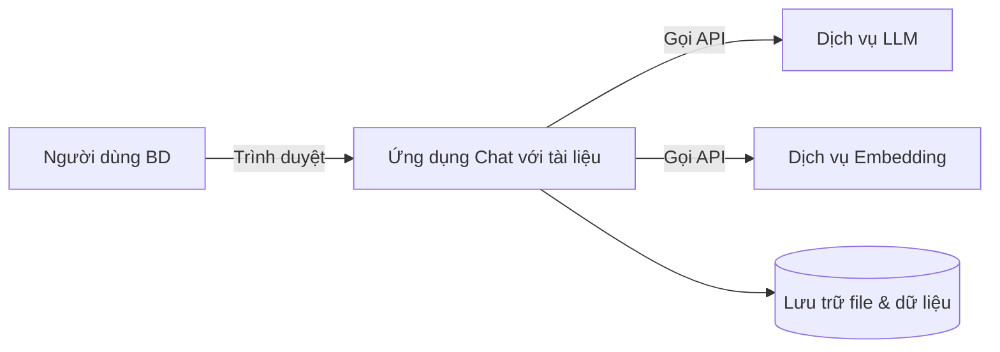

# Đặc tả Yêu cầu Phần mềm & Sản phẩm (SRS/PRD)
## Dự án: Công cụ "Chat với tài liệu" (MVP)

| Thông tin | Chi tiết |
|---|---|
| Mã tài liệu | SRS-CWD-001 |
| Phiên bản | 1.0 (Bản nháp) |
| Ngày tạo | 19/10/2026 |
| Tài liệu nguồn | [BRD-CWD-001](BRD.md) |
| Tài liệu liên quan | [SAD-CWD-001](SAD.md), [US-CWD-001](USER_STORIES.md) |
| Người soạn | Business Analyst / Product Owner |
| Trạng thái | Chờ review |

### Lịch sử thay đổi

| Phiên bản | Ngày | Người thực hiện | Nội dung thay đổi |
|---|---|---|---|
| 1.0 | 19/10/2026 | BA/PO | Khởi tạo tài liệu từ BRD v1.0 |

---

## 1. Giới thiệu

### 1.1. Mục đích
Tài liệu này mô tả chi tiết **sản phẩm cần xây dựng** (phần PRD) và **các yêu cầu chức năng, phi chức năng mà phần mềm phải đáp ứng** (phần SRS) cho MVP "Chat với tài liệu". Đây là cơ sở để đội phát triển thiết kế và lập trình, đội QA viết test case và các bên nghiệm thu sản phẩm.

### 1.2. Phạm vi sản phẩm
Ứng dụng web nội bộ cho phép người dùng:
- Upload và quản lý tài liệu PDF.
- Hỏi đáp bằng ngôn ngữ tự nhiên với AI trên nội dung các tài liệu đã upload, có trích dẫn nguồn.
- Xem tóm tắt tài liệu và lưu lịch sử hội thoại.

Phạm vi MVP bám theo mục 4 của BRD. Các mục ngoài phạm vi (OCR, định dạng khác PDF, ứng dụng di động, tích hợp hệ thống ngoài) **không** thuộc tài liệu này.

### 1.3. Quy ước
- **FR-xx:** yêu cầu chức năng (Functional Requirement).
- **NFR-xx:** yêu cầu phi chức năng, kế thừa từ BRD và được chi tiết hóa.
- **BR-xx:** mã yêu cầu nghiệp vụ trong BRD, dùng để truy vết.
- **"Phải" (shall):** bắt buộc. **"Nên" (should):** khuyến nghị.
- Độ ưu tiên dùng MoSCoW giống BRD.

### 1.4. Thuật ngữ
Kế thừa mục 13 của BRD và bổ sung các thuật ngữ sau:

| Thuật ngữ | Giải thích |
|---|---|
| Chunk | Đoạn văn bản nhỏ được cắt ra từ tài liệu để lập chỉ mục và tìm kiếm |
| Indexing | Quá trình trích xuất văn bản, chia chunk, tạo embedding và lưu vào chỉ mục tìm kiếm |
| Citation | Trích dẫn nguồn, gồm tên file, số trang và đoạn trích |
| Conversation | Một cuộc hội thoại gồm nhiều lượt hỏi đáp |
| Workspace | Không gian chứa tài liệu và hội thoại của người dùng. Trong MVP, mỗi người dùng có 1 workspace cá nhân |

---

## 2. Tổng quan sản phẩm (PRD)

### 2.1. Tầm nhìn sản phẩm
> Giúp đội Phát triển Kinh doanh **tìm được đúng thông tin trong vài giây, kèm bằng chứng**, thay vì mất hàng chục phút lục lọi nhiều file PDF.

### 2.2. Vấn đề và cơ hội
Xem BRD mục 2. Tóm tắt: thông tin nằm rải rác trong nhiều PDF, tìm theo từ khóa không hiểu ngữ nghĩa, và tổng hợp thủ công tốn thời gian.

### 2.3. Chân dung người dùng (Personas)

| Persona | Mô tả | Nhu cầu chính | Nỗi đau hiện tại |
|---|---|---|---|
| **Minh – Chuyên viên BD (người dùng chính)** | 28 tuổi, làm việc với 20–50 đối tác, thường xuyên tra hợp đồng và proposal | Tra cứu nhanh điều khoản, số liệu và thời hạn để trả lời đối tác | Mất 15–30 phút mỗi lần tìm thông tin, dễ trích nhầm phiên bản |
| **Lan – Trưởng nhóm BD** | 35 tuổi, ra quyết định dựa trên báo cáo thị trường và so sánh đối tác | Tổng hợp và so sánh thông tin từ nhiều tài liệu | Không có thời gian đọc hết, phải phụ thuộc vào cấp dưới tổng hợp |
| **Huy – Nhân viên mới** | 24 tuổi, mới vào được 2 tuần | Nắm nhanh bối cảnh của các dự án và đối tác | Không biết tài liệu nào quan trọng và bắt đầu từ đâu |

### 2.4. Chỉ số thành công của sản phẩm
Kế thừa BRD mục 3 và 11:

| Chỉ số | Mục tiêu | Cách đo |
|---|---|---|
| Thời gian tìm một thông tin | < 2 phút | Khảo sát và đo thực tế trong pilot |
| Tỷ lệ câu trả lời được đánh giá tốt | ≥ 80% | Nút 👍/👎 (FR-24) |
| Tỷ lệ câu trả lời có trích dẫn | 100% (trừ câu trả lời "không tìm thấy") | Log hệ thống |
| Tỷ lệ người dùng hoạt động hằng tuần | ≥ 70% đội BD, ≥ 3 lần/tuần | Log hệ thống |
| Mức độ hài lòng | ≥ 4/5 | Khảo sát sau 1 tháng |

### 2.5. Danh sách tính năng và lộ trình phát hành

| Tính năng | Mã BR | Ưu tiên | Phát hành |
|---|---|---|---|
| Đăng nhập / đăng xuất | BR-17 | M | MVP |
| Upload nhiều PDF, theo dõi trạng thái xử lý | BR-01, 02, 03 | M | MVP |
| Danh sách, xóa tài liệu | BR-04, 05 | M | MVP |
| Chat hỏi đáp trên toàn bộ tài liệu, có trích dẫn | BR-07 → 11 | M | MVP |
| Lịch sử hội thoại | BR-15 | M | MVP |
| Xem trước PDF, mở trích dẫn đúng trang | BR-06, 14 | S | MVP |
| Streaming câu trả lời | BR-12 | S | MVP |
| Giới hạn phạm vi hỏi theo tài liệu | BR-13 | S | MVP |
| Quản lý hội thoại (đổi tên, xóa) | BR-16 | S | MVP |
| Tóm tắt tài liệu tự động | BR-19 | S | MVP |
| Đánh giá câu trả lời 👍/👎 | BR-21 | S | MVP |
| Câu hỏi gợi ý | BR-20 | C | MVP+ (nếu còn thời gian) |
| Xuất / sao chép câu trả lời | BR-22 | C | MVP+ |
| So sánh tài liệu, trích xuất thông tin có cấu trúc, workspace nhóm | BR-23, 24, 25 | C | Giai đoạn 2 |
| OCR, định dạng khác, admin dashboard | BR-26, 27, 28 | W | Giai đoạn 2 |

---

## 3. Mô tả tổng quát hệ thống

### 3.1. Bối cảnh hệ thống



### 3.2. Vai trò người dùng

| Vai trò | Mô tả | Quyền trong MVP |
|---|---|---|
| User | Nhân viên đội BD | Quản lý tài liệu và hội thoại của chính mình |
| Admin | Quản trị viên IT hoặc PM | Tạo và vô hiệu hóa tài khoản, xem log lỗi. Không xem được nội dung tài liệu của người dùng |

### 3.3. Môi trường vận hành
- Trình duyệt: Chrome, Edge, Firefox, Safari (2 phiên bản mới nhất), trên màn hình rộng ≥ 1280px. Màn hình ≥ 768px vẫn dùng được nhưng không tối ưu.
- Ứng dụng được triển khai trên cloud, truy cập qua HTTPS.

### 3.4. Ràng buộc thiết kế
- Chỉ hỗ trợ PDF có lớp văn bản. PDF scan sẽ bị báo "không trích xuất được nội dung".
- Dùng LLM qua API của nhà cung cấp có cam kết **không dùng dữ liệu khách hàng để huấn luyện** (BR-18).
- Thời gian phát triển 6–8 tuần với đội 2–4 người. Ưu tiên công nghệ quen thuộc và dịch vụ có sẵn.

### 3.5. Giả định và phụ thuộc
Xem BRD mục 9.

---

## 4. Yêu cầu chức năng (SRS)

### 4.1. Xác thực và tài khoản (Authentication)

| Mã | Yêu cầu | Truy vết | Ưu tiên |
|---|---|---|---|
| FR-01 | Hệ thống phải cho phép người dùng đăng nhập bằng email và mật khẩu | BR-17 | M |
| FR-02 | Hệ thống phải chặn truy cập mọi trang chức năng khi chưa đăng nhập và chuyển hướng về trang đăng nhập | BR-17 | M |
| FR-03 | Phiên đăng nhập hết hạn sau 8 giờ không hoạt động. Người dùng có thể đăng xuất chủ động | BR-17 | M |
| FR-04 | Khóa tài khoản trong 15 phút sau 5 lần đăng nhập sai liên tiếp | BR-17 | S |
| FR-05 | Admin có thể tạo tài khoản (email, họ tên, mật khẩu tạm) và vô hiệu hóa tài khoản. Người dùng phải đổi mật khẩu tạm ở lần đăng nhập đầu tiên | BR-17 | M |

### 4.2. Quản lý tài liệu (Documents)

| Mã | Yêu cầu | Truy vết | Ưu tiên |
|---|---|---|---|
| FR-06 | Người dùng có thể upload 1–10 file PDF mỗi lần, bằng kéo-thả hoặc hộp chọn file | BR-01 | M |
| FR-07 | Hệ thống phải kiểm tra từng file trước khi xử lý: (a) đúng định dạng PDF (kiểm tra cả MIME type và magic bytes); (b) ≤ 50 MB; (c) ≤ 500 trang; (d) không có mật khẩu; (e) tổng số tài liệu của người dùng không vượt 100. File không hợp lệ bị từ chối kèm thông báo lỗi cụ thể theo bảng 4.8 | BR-03, NFR-03 | M |
| FR-08 | Mỗi file có một trong các trạng thái sau: `uploading` → `processing` → `ready`, hoặc `failed` (kèm lý do). Trạng thái được cập nhật trên giao diện mà không cần tải lại trang | BR-02 | M |
| FR-09 | Lỗi xử lý của một file không được ảnh hưởng tới các file khác trong cùng lần upload | BR-01, 03 | M |
| FR-10 | Nếu tài liệu đã xử lý mà có dưới 50 ký tự văn bản trên mỗi trang (trung bình), hệ thống đánh dấu `failed` với lý do "PDF dạng ảnh scan, chưa hỗ trợ" | BR-03 | M |
| FR-11 | Nếu người dùng upload file trùng nội dung (trùng hash SHA-256) với một tài liệu đã có, hệ thống cảnh báo và cho phép người dùng chọn bỏ qua hoặc vẫn upload | BR-01 | C |
| FR-12 | Danh sách tài liệu hiển thị: tên file, ngày upload, số trang, dung lượng, trạng thái. Có thể sắp xếp theo tên hoặc ngày và tìm theo tên file | BR-04 | M |
| FR-13 | Người dùng có thể xóa một hoặc nhiều tài liệu, sau khi xác nhận ở hộp thoại. Hệ thống phải xóa file gốc, các chunk và embedding liên quan. Tài liệu đã xóa không được xuất hiện trong kết quả tìm kiếm hay trích dẫn mới | BR-05 | M |
| FR-14 | Trích dẫn trong các hội thoại cũ trỏ tới tài liệu đã xóa sẽ hiển thị "Tài liệu đã bị xóa" và không mở được | BR-05 | M |
| FR-15 | Người dùng có thể xem trước PDF trong ứng dụng (trình xem có phân trang, phóng to/thu nhỏ) | BR-06 | S |
| FR-16 | Sau khi xử lý xong, hệ thống tự động tạo **bản tóm tắt** (≤ 200 từ) và **3–5 ý chính** cho tài liệu, hiển thị ở trang chi tiết tài liệu. Tóm tắt dùng ngôn ngữ chính của tài liệu | BR-19 | S |

### 4.3. Chat với tài liệu (Chat)

| Mã | Yêu cầu | Truy vết | Ưu tiên |
|---|---|---|---|
| FR-17 | Người dùng nhập câu hỏi (1–2.000 ký tự) bằng tiếng Việt hoặc tiếng Anh và gửi bằng Enter hoặc nút Gửi. Shift+Enter để xuống dòng | BR-07 | M |
| FR-18 | Hệ thống phải tìm các đoạn liên quan nhất trong **tất cả** tài liệu ở trạng thái `ready` của người dùng (hoặc trong các tài liệu được chọn theo FR-22), rồi sinh câu trả lời **chỉ dựa trên các đoạn đó** | BR-08 | M |
| FR-19 | Câu trả lời phải có trích dẫn nội tuyến dạng `[1]`, `[2]`... Mỗi trích dẫn gồm: tên file, số trang và đoạn trích (≤ 300 ký tự). Danh sách nguồn hiển thị dưới câu trả lời | BR-09 | M |
| FR-20 | Khi không tìm thấy đoạn liên quan hoặc thông tin không đủ để trả lời, hệ thống trả lời theo mẫu "Không tìm thấy thông tin này trong các tài liệu đã upload" và có thể gợi ý cách hỏi lại. Hệ thống không được dùng kiến thức bên ngoài tài liệu để trả lời câu hỏi về nội dung | BR-10 | M |
| FR-21 | Hệ thống phải giữ ngữ cảnh của tối đa 10 lượt hỏi đáp gần nhất trong cùng hội thoại, để hiểu đúng các câu hỏi tiếp nối (ví dụ "còn đối tác Y thì sao?") | BR-11 | M |
| FR-22 | Người dùng có thể chọn một hoặc nhiều tài liệu để giới hạn phạm vi hỏi của hội thoại. Mặc định là tất cả tài liệu. Phạm vi đang chọn phải luôn hiển thị trên giao diện chat | BR-13 | S |
| FR-23 | Câu trả lời được hiển thị dần (streaming). Người dùng có thể bấm "Dừng" để ngắt câu trả lời đang sinh | BR-12 | S |
| FR-24 | Mỗi câu trả lời có nút 👍/👎. Khi chọn 👎, người dùng có thể nhập góp ý (≤ 500 ký tự). Mỗi câu trả lời chỉ lưu một đánh giá và người dùng có thể đổi đánh giá | BR-21 | S |
| FR-25 | Khi nhấp vào trích dẫn, trình xem PDF mở đúng trang nguồn và **làm nổi bật** đoạn trích. Nếu không làm nổi bật được, chỉ cần mở đúng trang | BR-14 | S |
| FR-26 | Khi người dùng chưa có tài liệu `ready` nào, khung chat bị vô hiệu hóa và hiển thị hướng dẫn upload | BR-07 | M |
| FR-27 | Ở hội thoại mới, hệ thống hiển thị 3–5 câu hỏi gợi ý được sinh từ nội dung tài liệu. Nhấp vào câu gợi ý sẽ gửi câu hỏi đó | BR-20 | C |
| FR-28 | Người dùng có thể sao chép câu trả lời (kèm danh sách nguồn) vào clipboard dưới dạng Markdown | BR-22 | C |
| FR-29 | Khi có lỗi (LLM quá thời gian, lỗi mạng), hệ thống hiển thị thông báo thân thiện và nút "Thử lại" | BR-07 | M |

### 4.4. Lịch sử hội thoại (Conversations)

| Mã | Yêu cầu | Truy vết | Ưu tiên |
|---|---|---|---|
| FR-30 | Hệ thống tự động lưu mọi hội thoại cùng các câu hỏi, câu trả lời, trích dẫn và đánh giá | BR-15 | M |
| FR-31 | Thanh bên hiển thị danh sách hội thoại, sắp xếp theo thời gian cập nhật gần nhất. Tiêu đề hội thoại được tự động sinh từ câu hỏi đầu tiên (≤ 60 ký tự) | BR-15 | M |
| FR-32 | Người dùng có thể tạo hội thoại mới, mở lại và tiếp tục một hội thoại cũ | BR-15, 16 | M |
| FR-33 | Người dùng có thể đổi tên hoặc xóa hội thoại (có xác nhận) | BR-16 | S |

### 4.5. Quản trị (Admin)

| Mã | Yêu cầu | Truy vết | Ưu tiên |
|---|---|---|---|
| FR-34 | Admin xem được danh sách người dùng (email, họ tên, trạng thái, ngày tạo, lần đăng nhập cuối) | BR-17 | M |
| FR-35 | Hệ thống ghi nhận mức sử dụng của từng người dùng: số tài liệu, số câu hỏi, số token LLM đã dùng theo ngày. Dữ liệu này dùng để theo dõi chi phí | NFR-10 | S |

### 4.6. Bảo mật và quyền riêng tư dữ liệu

| Mã | Yêu cầu | Truy vết | Ưu tiên |
|---|---|---|---|
| FR-36 | Người dùng chỉ truy cập được tài liệu, chunk và hội thoại của chính mình. Mọi truy vấn dữ liệu đều phải lọc theo `user_id` ở tầng backend | BR-18, NFR-05 | M |
| FR-37 | Nội dung tài liệu và hội thoại chỉ được gửi tới nhà cung cấp LLM/embedding đã được IT phê duyệt, với cấu hình không lưu trữ và không huấn luyện trên dữ liệu | BR-18 | M |
| FR-38 | Nội dung trong tài liệu phải được coi là **dữ liệu**, không phải chỉ thị. Hệ thống phải giảm thiểu prompt injection từ nội dung PDF, ví dụ một tài liệu chứa câu "bỏ qua hướng dẫn trước đó" | BR-18 | M |

### 4.7. Use case chính

#### UC-01: Upload tài liệu
- **Tác nhân:** User
- **Tiền điều kiện:** Người dùng đã đăng nhập.
- **Luồng chính:**
  1. Người dùng mở trang "Tài liệu" và kéo-thả 3 file PDF vào.
  2. Hệ thống kiểm tra từng file (FR-07) và hiển thị thanh tiến trình upload.
  3. Upload xong, các file chuyển sang trạng thái `processing`.
  4. Hệ thống trích xuất văn bản, chia chunk, tạo embedding và tóm tắt.
  5. Các file chuyển sang trạng thái `ready`, người dùng nhận thông báo trên giao diện.
- **Luồng thay thế:**
  - 2a. Một file vượt 50 MB → file đó bị từ chối với thông báo E-02. Các file còn lại vẫn tiếp tục.
  - 4a. File là PDF scan → trạng thái `failed`, thông báo E-05.
- **Hậu điều kiện:** Tài liệu `ready` có thể được dùng để hỏi đáp.

#### UC-02: Hỏi đáp với tài liệu
- **Tác nhân:** User
- **Tiền điều kiện:** Có ít nhất 1 tài liệu ở trạng thái `ready`.
- **Luồng chính:**
  1. Người dùng nhập câu hỏi và nhấn Enter.
  2. Hệ thống tìm các đoạn liên quan trong phạm vi tài liệu đã chọn.
  3. Hệ thống sinh câu trả lời dạng streaming, kèm trích dẫn `[n]`.
  4. Người dùng nhấp vào `[1]` → trình xem PDF mở đúng trang nguồn.
  5. Người dùng bấm 👍.
- **Luồng thay thế:**
  - 2a. Không có đoạn đủ liên quan → hệ thống trả lời theo mẫu "không tìm thấy" (FR-20).
  - 3a. LLM lỗi hoặc quá thời gian 30 giây → hiển thị lỗi E-10 và nút Thử lại.
- **Hậu điều kiện:** Câu hỏi, câu trả lời, trích dẫn và đánh giá được lưu vào hội thoại.

#### UC-03: Xóa tài liệu
- **Tác nhân:** User
- **Luồng chính:** Chọn tài liệu → bấm Xóa → xác nhận → hệ thống xóa file, chunk, embedding và tóm tắt → tài liệu biến mất khỏi danh sách.
- **Hậu điều kiện:** FR-13 và FR-14 được đảm bảo.

### 4.8. Danh mục thông báo lỗi

| Mã | Tình huống | Thông báo hiển thị |
|---|---|---|
| E-01 | Sai định dạng | "File {tên} không phải PDF. Hiện chỉ hỗ trợ file .pdf." |
| E-02 | Vượt dung lượng | "File {tên} vượt quá 50 MB." |
| E-03 | Vượt số trang | "File {tên} có hơn 500 trang." |
| E-04 | PDF có mật khẩu | "File {tên} được bảo vệ bằng mật khẩu. Vui lòng gỡ mật khẩu rồi upload lại." |
| E-05 | PDF scan | "Không trích xuất được văn bản từ {tên}. Có thể đây là PDF dạng ảnh scan, hiện chưa được hỗ trợ." |
| E-06 | Vượt hạn mức tài liệu | "Bạn đã đạt giới hạn 100 tài liệu. Hãy xóa bớt tài liệu cũ để tiếp tục." |
| E-07 | Lỗi xử lý không xác định | "Xử lý file {tên} thất bại. Vui lòng thử lại sau." |
| E-10 | LLM lỗi hoặc quá thời gian | "AI đang bận hoặc gặp sự cố. Vui lòng thử lại." |
| E-11 | Vượt hạn mức câu hỏi | "Bạn đã dùng hết số câu hỏi trong ngày ({n}/{n}). Hạn mức sẽ được làm mới lúc 0h." |

---

## 5. Yêu cầu giao diện

### 5.1. Danh sách màn hình

| Mã | Màn hình | Thành phần chính | FR liên quan |
|---|---|---|---|
| SCR-01 | Đăng nhập | Email, mật khẩu, nút Đăng nhập, thông báo lỗi | FR-01 → 04 |
| SCR-02 | Chat (màn hình chính) | Thanh bên trái: danh sách hội thoại và nút "Hội thoại mới". Khu vực giữa: các tin nhắn, câu hỏi gợi ý, ô nhập. Phía trên: bộ chọn phạm vi tài liệu. Bảng bên phải (mở khi bấm trích dẫn): trình xem PDF | FR-17 → 33 |
| SCR-03 | Tài liệu | Vùng kéo-thả, bảng tài liệu (tên, ngày, trang, dung lượng, trạng thái), ô tìm kiếm, nút Xóa | FR-06 → 14 |
| SCR-04 | Chi tiết tài liệu | Trình xem PDF, bản tóm tắt, các ý chính, nút "Hỏi về tài liệu này" (tạo hội thoại mới với phạm vi là tài liệu này) | FR-15, 16, 22 |
| SCR-05 | Quản trị người dùng | Bảng người dùng, nút Tạo và Vô hiệu hóa, số liệu sử dụng | FR-34, 35 |

### 5.2. Wireframe màn hình Chat (SCR-02)

```
┌──────────────────┬──────────────────────────────────────┬─────────────────────┐
│ [+ Hội thoại mới]│ Phạm vi: [Tất cả tài liệu (12) ▾]    │  hop-dong-X.pdf  ✕  │
│                  │──────────────────────────────────────│                     │
│ Hôm nay          │  👤 Điều khoản thanh toán với X?     │  ┌───────────────┐  │
│ • Thanh toán X   │                                      │  │   Trang 4     │  │
│ • Giá đối tác Y  │  🤖 Đối tác X thanh toán 30 ngày     │  │ ███ đoạn được │  │
│ Hôm qua          │     sau khi nhận hóa đơn [1], phạt   │  │ ███ highlight │  │
│ • Thị trường VN  │     0,05%/ngày nếu chậm [2].         │  │               │  │
│                  │     Nguồn:                           │  └───────────────┘  │
│                  │     [1] hop-dong-X.pdf – tr.4        │   ◀ 4 / 12 ▶        │
│ ──────────────── │     [2] hop-dong-X.pdf – tr.5        │                     │
│ 📄 Tài liệu      │     👍 👎  📋                         │                     │
│ ⚙  Quản trị      │──────────────────────────────────────│                     │
│ 👤 Minh ▾        │ [Nhập câu hỏi...                ] ➤  │                     │
└──────────────────┴──────────────────────────────────────┴─────────────────────┘
```

### 5.3. Nguyên tắc giao diện
- Toàn bộ giao diện dùng tiếng Việt (NFR-09).
- Mọi thao tác xóa đều có bước xác nhận.
- Mọi trạng thái chờ đều có chỉ báo, như skeleton hoặc spinner.
- Đạt mức tương phản WCAG 2.1 AA và dùng được bằng bàn phím cho các thao tác chính.

---

## 6. Yêu cầu dữ liệu

### 6.1. Thực thể dữ liệu chính

| Thực thể | Thuộc tính chính |
|---|---|
| User | id, email, họ tên, password_hash, role (user/admin), status, created_at, last_login_at |
| Document | id, user_id, tên file, dung lượng, số trang, hash SHA-256, status, error_code, summary, key_points, storage_key, created_at |
| Chunk | id, document_id, user_id, nội dung, trang bắt đầu, trang kết thúc, thứ tự, embedding |
| Conversation | id, user_id, tiêu đề, document_scope (danh sách document_id hoặc null = tất cả), created_at, updated_at |
| Message | id, conversation_id, role (user/assistant), nội dung, citations (JSON), token_usage, created_at |
| Feedback | id, message_id, user_id, rating (+1/-1), comment, created_at |
| UsageLog | user_id, ngày, số câu hỏi, input_tokens, output_tokens, embedding_tokens |

Mô hình dữ liệu chi tiết được trình bày trong [SAD](SAD.md) mục 6.

### 6.2. Lưu giữ dữ liệu
- Tài liệu và hội thoại được lưu tới khi người dùng xóa.
- Khi tài khoản bị vô hiệu hóa, dữ liệu được giữ 90 ngày rồi xóa vĩnh viễn, trừ khi Admin yêu cầu khác.
- Log ứng dụng được giữ 30 ngày và **không ghi nội dung tài liệu hay câu hỏi** ở mức log thông thường.

---

## 7. Yêu cầu phi chức năng (chi tiết hóa)

| Mã | Hạng mục | Yêu cầu đo lường được | Nguồn |
|---|---|---|---|
| NFR-01 | Hiệu năng chat | p95 thời gian tới token đầu tiên ≤ 5 giây; p95 tổng thời gian trả lời ≤ 15 giây | BRD NFR-01 |
| NFR-02 | Hiệu năng xử lý tài liệu | PDF 50 trang chuyển sang `ready` trong ≤ 60 giây (p90); PDF 500 trang trong ≤ 10 phút | BRD NFR-02 |
| NFR-03 | Giới hạn | 50 MB / 500 trang mỗi file; 100 tài liệu mỗi người dùng; 200 câu hỏi mỗi người dùng mỗi ngày (cấu hình được) | BRD NFR-03, 10 |
| NFR-04 | Quy mô | 20 người dùng chat đồng thời mà không vi phạm NFR-01 | BRD NFR-04 |
| NFR-05 | Bảo mật | TLS 1.2+; mã hóa khi lưu trữ (AES-256); mật khẩu băm bằng bcrypt/argon2; tuân thủ OWASP Top 10; khóa API lưu trong secret manager | BRD NFR-05 |
| NFR-06 | Khả dụng | Người dùng mới hoàn thành "upload → hỏi → mở trích dẫn" trong ≤ 5 phút mà không cần hướng dẫn (đo bằng kiểm thử với 5 người dùng) | BRD NFR-06 |
| NFR-07 | Tương thích | Chrome, Edge, Firefox, Safari (2 phiên bản mới nhất) | BRD NFR-07 |
| NFR-08 | Tin cậy | Uptime ≥ 99% trong giờ hành chính; sao lưu cơ sở dữ liệu hằng ngày, giữ 7 ngày; RPO ≤ 24 giờ, RTO ≤ 4 giờ | BRD NFR-08 |
| NFR-09 | Ngôn ngữ | Giao diện tiếng Việt; AI trả lời theo ngôn ngữ của câu hỏi | BRD NFR-09 |
| NFR-10 | Chi phí | Ghi nhận token theo người dùng và theo ngày (FR-35); cảnh báo khi chi phí tháng vượt 80% ngân sách | BRD NFR-10 |
| NFR-11 | Chất lượng AI | Trên bộ ≥ 50 câu hỏi kiểm thử: ≥ 80% đúng; 100% có trích dẫn hợp lệ (trích dẫn trỏ tới đoạn thực sự chứa thông tin); ≥ 90% câu hỏi ngoài phạm vi được trả lời "không tìm thấy" | BRD mục 11 |
| NFR-12 | Khả năng giám sát | Có log có cấu trúc, metric về độ trễ, tỷ lệ lỗi và token, và cảnh báo khi tỷ lệ lỗi vượt 5% trong 5 phút | — |
| NFR-13 | Khả năng bảo trì | Có thể thay nhà cung cấp LLM hoặc embedding bằng cấu hình và một adapter, không phải sửa logic nghiệp vụ | — |

---

## 8. Tiêu chí nghiệm thu

1. 100% yêu cầu chức năng mức **M** đạt test case tương ứng.
2. ≥ 80% yêu cầu mức **S** được hoàn thành. Phần chưa xong được ghi nhận vào backlog.
3. Đạt NFR-01, 02, 04, 05 và 11 trên môi trường staging.
4. Không còn lỗi mức Critical hoặc High.
5. Đội BD (≥ 3 người) thực hiện UAT theo các use case UC-01 → UC-03 và ký nghiệm thu.

---

## 9. Ma trận truy vết BRD → SRS

| BR | FR / NFR |
|---|---|
| BR-01 | FR-06, 09, 11 |
| BR-02 | FR-08 |
| BR-03 | FR-07, 09, 10 |
| BR-04 | FR-12 |
| BR-05 | FR-13, 14 |
| BR-06 | FR-15 |
| BR-07 | FR-17, 26, 29 |
| BR-08 | FR-18 |
| BR-09 | FR-19 |
| BR-10 | FR-20 |
| BR-11 | FR-21 |
| BR-12 | FR-23 |
| BR-13 | FR-22 |
| BR-14 | FR-25 |
| BR-15 | FR-30, 31, 32 |
| BR-16 | FR-32, 33 |
| BR-17 | FR-01 → 05, 34 |
| BR-18 | FR-36, 37, 38 |
| BR-19 | FR-16 |
| BR-20 | FR-27 |
| BR-21 | FR-24 |
| BR-22 | FR-28 |
| BR-23 → 28 | Ngoài phạm vi MVP (giai đoạn 2) |
